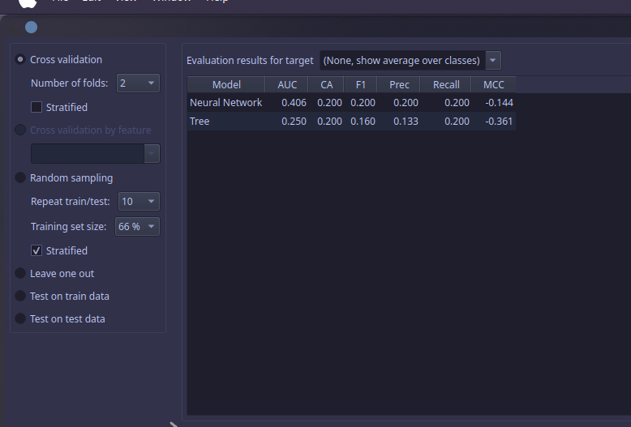
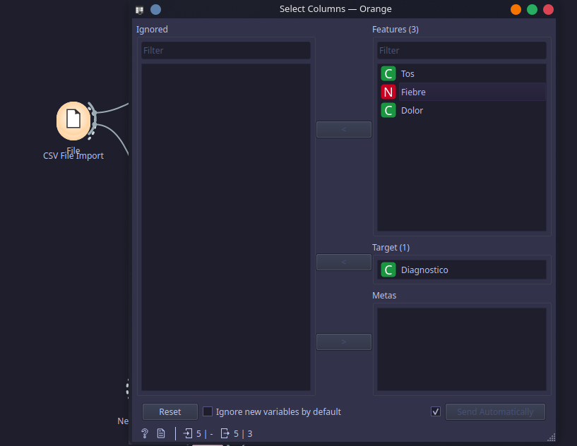
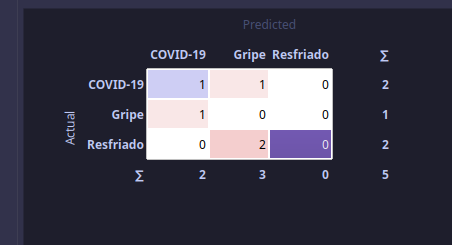

# Oragne Data Mining
**IA Supervisado** 

1. Clasificacion
2. Regtresion

```bash
(Arbol De desision, KNN, SVM, RNA, etc)
```


## Ejemplo
1. option
2. imagen_Analitycs

## Matriz de Confusion
1. Cargar Datos
2. Preprocesamiento(completar datos faltantes y eliminar los datos ducplicados)
3. elegir columnas con las que se tarbaja(Las columans con datos unicos se **eliman**)
- Los datos unicos pueden provocar **sobreajustes**



---


La matriz de Confusionnsolamente se puede hacer con clasificacion
- Clasificasion Cuando **Las Salidas Son Contadas**
- Regresion **Salidas Infinitas**


**INvestigar SobreAjuste**
