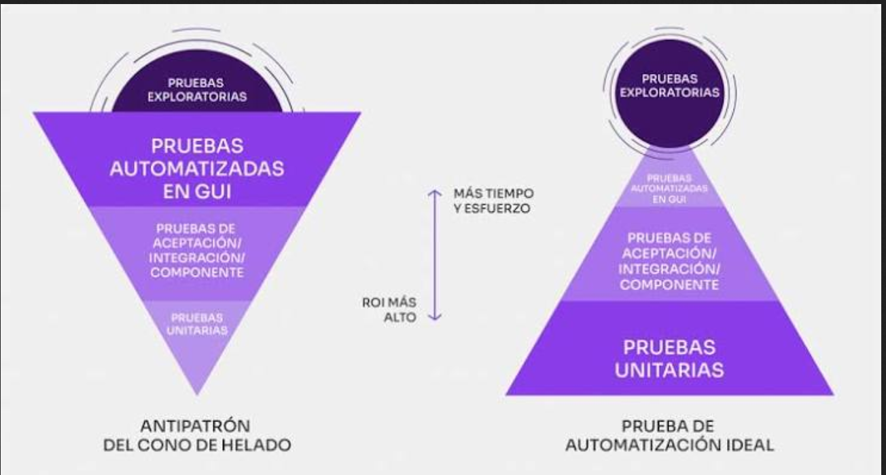
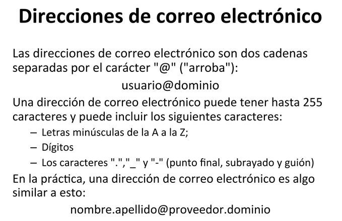

# Tema 5 Automatizar por niveles Unitarias y Api


**Cuando no se automatiza ??**

- Cuando No es Repetitivo.
- cuando Mantenerlo.
- Cuando Mantenerlo es mayor a Automatizarlo.


**Objetivod**
- Entender que s eautomatiza, en el nivel unitario y Api
- Diferenciar el Rol del DEV, y la del SA en cada nivel
- Diseñar casos de pruebas de API
 ## La piramide aplicada
 
 - Pruebas UI 10%
 - Costo Medio 20%
 - Unitarias/ Economicos tiempo RRHH 70%
 ## Pruebas Unitarias
 

 Que es un aprueba Unitaria??

 - **Vereifica** la unidad mas pequeña(CODIGO::Funcion, metodos, clase)
 - Aisla la unidad de sus dependencias.
 -  No toca BD, red ni UI
 ## Caracteristicas de una UNIt -- Test
 - **Rapido:** mas de mls, no debe de pasar los 5 segundos.
 -  **Aislada:** No debe de depender de ningunn externo
 - **Determinsta:** Mismo imput ==> mismo output, **Siempre**
 - **Repetible :** Se debe de ejecutar miles de veces sin efectos secundarios.
 - **Una sola Cosa:** Prueba un comportamiento no 10.
 ## Quien escribe las UNIT-Test
 **Tradicionalmente** El dev

 **Rol del QA??**
 - revisa todod los casos o al menos los mas riticos.
 - Verefica el porsentaje de la cobertura
 - Sugerir casos borde que el Dev no considero
 - Revisar en el COde Review (CR) donde podrian fallar.

 ***El QA escribe unitarias, pero las revisa y las usa como red de seguridad***

 **Ejemplo**

 Funcion *validar campo correo*
 **Casos**:
 - *@ en el correo "abc@xy.com"*
 - *revisar dominios*
    1. gmail
    2. aoutbok
    3. hotmail

    - No corresponde el dominio se crea a menudo
    - 

    ## Herramientas por lenguaje
    - **Java** JUNIT, testNG.
    - **.NET** Nunit, xUnit.
    - **Python** Pytest, unittest.
    - **JavaScript/typscript:** Jest, Mocha
## Estructura de un UNIT-TEST

**AAA**

**Orange** preparar datos y dependendencias.

**Act** ejecutar unidad.

**Assert** vereficar resultados esperados.

**EJEMPLO**

Calcular el Monto del impuesto, dado el costo total.

- **Funcion** Calcular Impuesto(CostoTotal)

**Casos**
```math
Costo Total={0, 100, 0.1, -1}
```
```math
Resultados={0,16,0.016,exp}
```
1. Aprawge
2. Aot
3. Assert

***Analizar siempre casos limitel borde en el ejemplo: 0, -1***

## Cobertura de codigo Que es Y que No Es??
Cobertura de % de linias raams ejecuetadas por las unit-test

No es Una meta absoluta al 100% de cobertura no garantiza bugs.

Sirve como una señal si una rama critica nio esta cubierta hay riesgos

En el DoD (defenitiion of Done) se suele pedir un 80%
***Se acuerda con% con el DEV***

**EJMEPLO**

***Ordenar dos  numeros de a,b de mayor a menor***
```py
a = N
b = N

if (a > b ){
    print("PRINT"a, b)
    elif b > a:
        print("PRINT"b,a)

}
```
|id|password|Result|
|--|--|--|
|1|holaPat1|
|2|047293Ea|
|3|g83r4132|
|4|ubv31eu9|
|5|12345678|
|6|@@@@@@@@|

```py

 