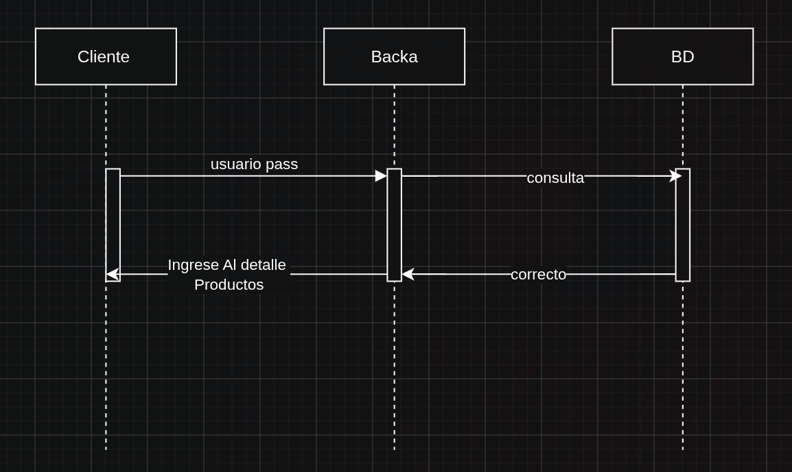

# Unidad 5

Roles en Scrum Interacciones del QA

**El QA y el Product Owner (P.O)**

* Es Co-creador de los criterios de aceptacion (A.C)
*  Participan En la Redaccion qque seam  Testeables
 ```bash
 El Sistema debe de ser rapido en Donde la pagina de inicio debe de cargar en 2 segundos
 ```
 En Donde un Ej(el Sistyema debe de cargar menos de 2 segundos)
 en la que la informacuion de presentacion debe de mostrar el informe con al prueba
 ```bash
 ej = AC " La pagina de inicio debe de cargar en menos de 2 segundos con 100 ususarios recurentes"
 ```
 ## Orden en la que debe de cumplir
 * Este debe de cumplir Los siguientes ordenes ademas que deben de ser Muy Detallada en donde la accion debed e ser detallada y la accion puede ser mas Infalible
 * El QA ayuda a priorizar el backlog por riesgo de calidad
 Un AC debe de cunmplir el siguiente orden
 ```md
 entrada ==> accion ==> resultado
 ```
```md
 1. Historias con mucho riesgo Tecnico
 2. .. Concurencia
 3. .. Seguridad
 4. .. Pruebas de Regrcion , funcionanmiento, psot de implementacion

```

**EL QA aporta la dimencion de riesgo  tecnico**

```md
"Investigar mas detalle de Product Baclog"
1. creacion de inicio
2. crud de productos
3. cliente frecuente
4. roles de usuario
5. alerta de bajo costo
6. productos mas consultados
7. modelo de Ia , prediccion de ventas
8. modelo de Ia recomendado
9. crud de clientes
```

## El QA Hace Preguntas Que el PO no se hizo antes

* **ANticipa ecenarioos np contepaldos**
* que pasa si el usuario no tinene permisos ?
* Que pasa si el pago se rechaza a medio transaccion ?


En dodne el usario debe de Preguntarce Que pasaria **SI**
* Ejemplos
1. Que pasa si BD nos devuelve incorrecto?
2. Que Pasaria **Si** ingreso Caracter Extraño
3. Cuantos Intentos Tengo
## El QA y EL SCRUM MAster
* ElQA identifica impedimientos de testing y las escalaas al AM
* El S.M , no arregla el impedimiento pero puede eliminar del camino.
1.  Gestiona Recursos
2. habla con terceros
3. priorizar
El QA no se queja, nombra el impedimiento  con presicion

```bash
No puede probra por que necesira datos de prueba en mayor cantidad
```

**Impedimientos Tipicos de Testing**
1. Entornos Inestables
* No se pueden hacer transacciones
2. falta de herramientas
* test Malogrados o desactualizados
3. Dependencias Externas
* Falta de Postman , Github o entorno en la que se depende de algun servicio
4. falta de tiempor
* Por recarga de Trabajo

## 3 Los QAsy los Devs
* Qa y dev Prueban juntos una historia Compleja 
1. El dev exlica la logica
2. El QA diseña casos borde
Colaboracion Para encontrar bus mas rapido
* **Pair Programing Con enfoque de Pruebas donde podria fallar**
el Dev escribe el Codigo y el QA Sugiere donde podria faltar
* **Feedbak Temprano en el Code review Buen Momento para encontrar riesgos**

* Este Catch vacio ocultar errores, Deberia de Hacerlo
## Manejo de la "Deuda Tecnica De Pruebas"
* Bugs No reportados defectos queexistren pero nadie registro (oo)


