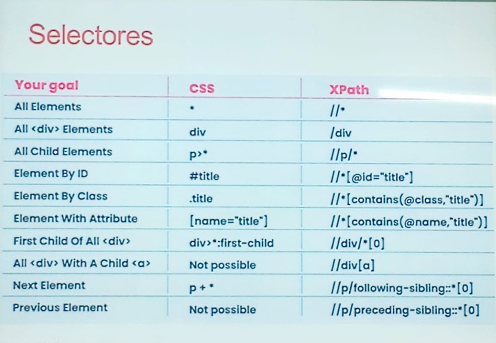
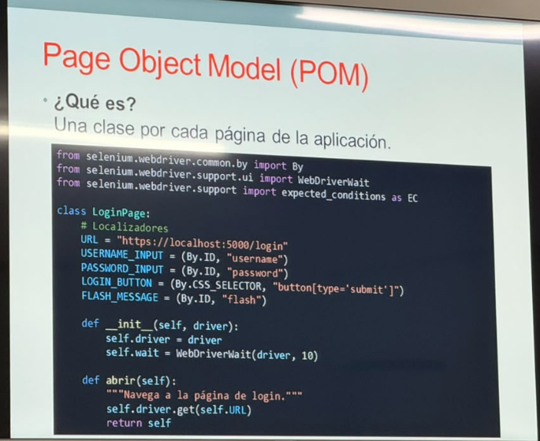
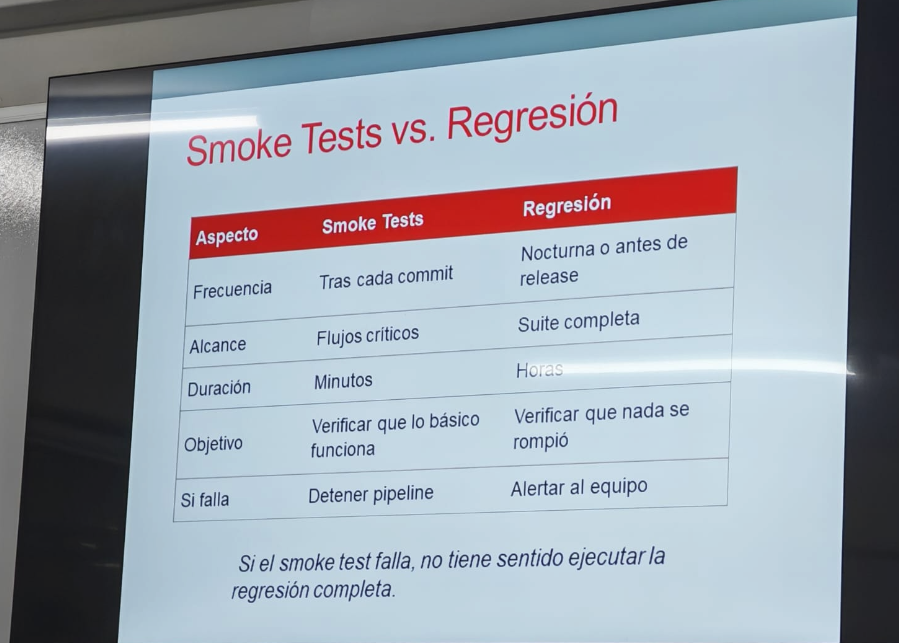

# tarea sobre redde sy sopa
## Tarea usar selenium en pruebas. APis , Selenium
la teroia de colores tiene efecto de psicologia en el usuario en dodne los colores deben de estrar destribuidos de manera correcta.

**selenium webDriver** Estandar de la industria multi-lernguaje(java, python, C#, Js)

**Cypress** Moderna, rapida, ideal para aplicaciones web modernas (react, vue, angular)

**Playwright** desarrollado por microsoft, soporta multiples navegadores y lenguajes.
## Selenium Webdriver - Caeracteristicas

**Multinavegador** Chrome, Firefoc, Edge, Safari

**Mul_Lenguaje_** Java, Python, C#, ruby, JavaScript

**Mul-Plataforma** Windos, Linux, Macos

**arquitectura** WevDriver actua como puente entr el script y el navegador
**Requiere** Driver especificos (ChromeDriver, GeckoDriver)

**Ventaja** Gran Comunidad , Documentales abundante

**DEsventajas** Mas ;ento que Cypress, Configuracion mas Compleja>

## CYpres _ Caracteristicas
**Solo JavaScript y TappyScript**

**Ejecucion de navegador** No neceistas drivers externos

**Rapido y confuiable** Espera automatica de elementos

**Time travel** puedes ver capturas de cada paso eejecutado

**Hot Reload**  Los cambios se reflejan en tiempo real

**Ideal para** Apicaciones web modernas (SPA)

**limitacion** No soporta multiples pestañas abiertas facilmente no es multi navegador nativo(aha mejorado).

## Playwright Caracteristicas
**Desarrollado por microsoft**

**multi navegador** chromium, firefox, webkit

**multi lenguaje** javascript, Typescript, python, java, net

**auto wait** espera automatica de elementos, al momento de cargar una pagina busca el selector en la que se ingresa el texto, auto Wait espera la pagina y despues busca los selectores que necesita. el selector se encarga de buscar partes de un input
```html
<input type = "text" id = "mail">
```
se encarga en encontrar los se;lectores que esten dentro de la pagina como el input, id mail, class, y tipo de texto.

**Captura de video y screenshots** integrado

**paralelizacion** excelente soporte

**ideal para** equispos que necesitan cobertura amplia de navegadores.
## Selectores Robustos
**Que es un selector??**

es la forma de identificar un elemneto en la pagina web
el selector puede obtener la cantidad de impust que este ne la pantalla
```css
'input - tetx'
```
devuelve 
```py
selector id ='mail'
vuelve input [type=text]

```
**relativo** busca un elemento y de esa encuentra a un nwe elemnto
**total** encuentra desde la paginna totoal
```html
<div id='login'>
<input />
<input />
<input />
<div>
```
el tipo de selectores 


## Buenas Practicas de selectores

* preferir Id o data-testing (estables)
* evitar Xpath absolutos (/html/body/div)
* evitar depender de textos que cambian
* usar atributos semanticps: name, role, aria-label
## Problemas comunes en UI Automation

**Fragiles** Si cmabia el diseño, fallan

**lentas** tarda segundos o minutos de pruebas

**caras de mantener** Cada cmabio en la UI implica cactualizar scrpts

**Flaky test** fallan intermitentemente por timming, red, etc. 

**solucion** no automatizar todo en UI, solo flujos criticos y estables.

## Automatizacion Movil

Automatizar las pruebas moviles (nativas, hibridas o web movil)

**Heramientas principales**

**Appium** Multiplataforma android + ios, multi-lenguaje

**XCUITest** nativo para IOS, desarrollado por Aplle

**expreso** nativo para android desarrollado por Google

## Desafios en Automatizacion Movil

**Diversidad de dispositivos** Pantallas, Resoluciones, veriosnes, de OS

**Getsos** Swipe, tap, pinch, Scroll

**Permisos** notificaciones. camara, ubicacion

**red** cambios entre Wifi, 4g, 5g, modo avion

**Emuladores vs Reales** los emuladores no siempre reflejan, el comportamiento real.

**Recomendaciones** Probar en dispositovosreales los flujos criticos.

## Patrones de Diseño- Introduccion

**POr que es importante**

* Organizar codigo
* facilitan el mantenimiento
* Permiten la reutilizacion
* Reducen  la duplicacion
* **Patrones principales**
* **page Object Model (POM)
* Screeanplay Pattern

Es una clase Por cada Ventana que s etiene

## Ventajas Del POM

**Manteniemiento centrealizado** Si cambia un selector se modifica en un solo lugar

**Reutilizacion** los metodos se pueden utiolizar en multioples pruebas

**legibilidad** el codigo de prueba se vuelve mas claro


**Separacion de responsabilidades** la pagina sabe como interpretar el test sabe que probar.
## Screenplay Pattern
**que es**
un patro orientado a comportamiernto, mas avanzada que POM

**Conceptos calves**

**Actor** el suauario que relaiza las acciones.

**Tarea (task)** accion de alto nivel(ej, iniciar session).

 **interaccion** accion bajo nivel (ej escribir en campo).

 **Pregunta** vereficacion (el mensaje es visible).

 **ventajas**

 * codigo mas legible y cercano al lenguaje natural
 * Altamente Reutilizable
 *idela para proyectos grandes y proyectos complejos.

 ## Pruebas Data-Driven

 que son el mismo script se ejecuta con multiples conjuntos de datos.

 **fuentes de datos** excel, (.xlsx, csv, json, data base).

 ## Integracion Continua (CI/CD)

 que es **CI Continuis integration**  integragar cofigo frecuente y ejecutar pruebas automaticas.

 **CD Continuod Delivery/Deployment** desplar automaticamente a entornos de pruebas o produccion.

 **Herramientas** Jenkins, Github actions, Gitlab Cl, CircleCl.
 ## Pepeline de pruebas
 **que es CI/DC**

 * CI **continuos integration** integran codigo frecuentemente y ejecutar pruebas automaticas.

 * CD **Continuos Delivery/Deployment** Desplegar automaticamente a entornos de Prueba o produccion

 * **Herramienta** jenkins, Github Actions, Gitlab CL,  CircleCl.

 en Pipeline pasa por varios procesos en un tubo por ejemplo
 ```bah
 ----------------------
 input |   |  |  | output
       |   |  |  | output
-----------------------
```
**Etapas Tipicas**

**bulid** Copilar Codigo

**Unit Test**** verefica lo basico por tars cada commit.

**Api Test** Validar contratos entre servicios.

**UI Test**  Validar contrato entre servicios

**Regresion Completa** Nocturna

Si el moske Test falla, no tiene sentido ejecutar la regresion completa


## Reportes y Dahnoard

**Por que son Importantes**

* dan visibilidad a los Resultados
* Permitan Tomar Decisiones Rapidas
* Facilitan la comunicacion con Stakeholders.

## QUe debe de incluir un bUen reporte?

**Resumen ehecutivo** Totral de Pruebas, pasadas, fallidas, optimas.

**detalle de fallos** Capturars de  pantallas, logs, stack, trace.

**Tiempos** Duraccion de cada Pruebas Total.

**tendencias** historicos de ejecuciones

**Trazabilidad** Vinculo con historias de usuarios o requisitos

**Categorizarcion** Por modulo, Por criticidad, POr tipo.