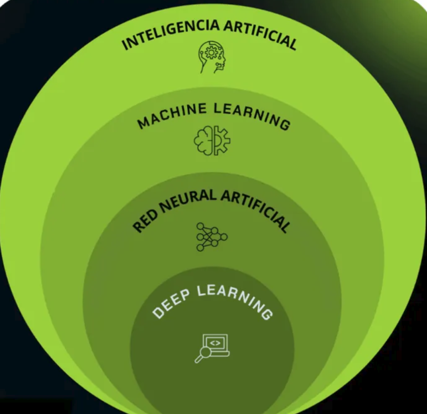
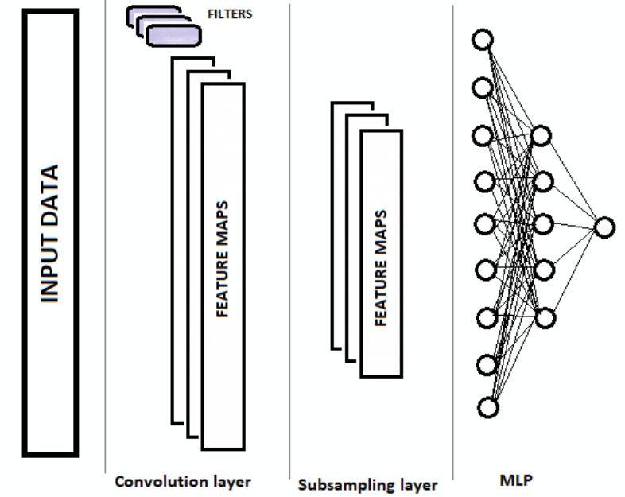
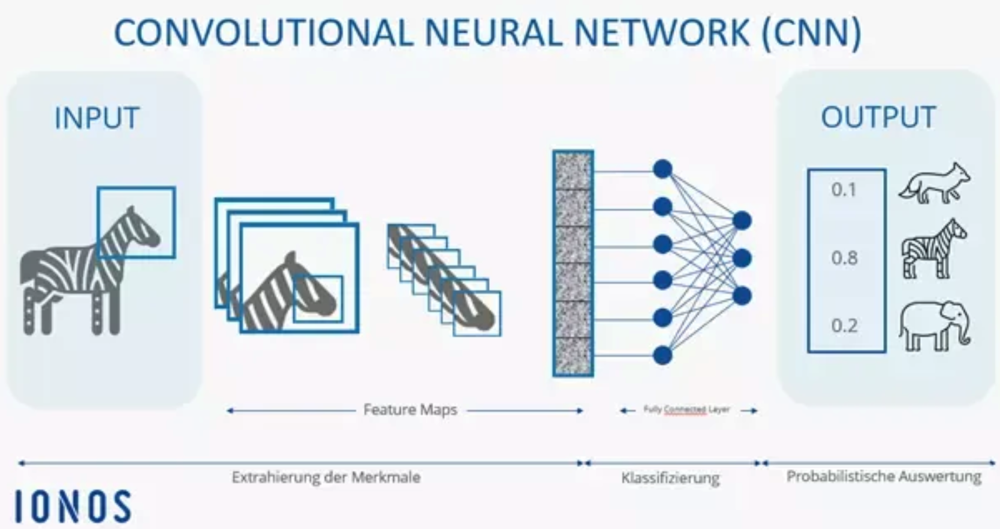

clear
# Division de tablas 
Para poder separar tablas de los que tyienen minimas columnas para aumentar la simplisidad de la misma se le puede agregar a **division tablas** en la cual para hacerlo se le puede usar.
1. LABELING
2. ONE HOT ENCODING

**ONE HOT ENCODING** se le puede usar para devir las columnas en donde si lo desea puede usar 0,1 a que se le llama a solo 0/1 es **EMBEDING**

**VECTORES** la base de datos en vectoriales se le traaja base de datos en **Vectores** y que es un vector es un **embeding**

##

Una red neuronal en donde entran palabras y  salen palabras, en donde se represnta texto a numeros en la que el texto  esta representada a numeros ,  en la cual cada letraesta reppresentada a una etiqueta numerica.

Para usae la codificacion en la, para etender el valor cuantitativo es poder que diferencie entre unos de otros para evitar **confundir datos con otros** como por ejmeplo(telefno, edad, el DNI de la persona, etc) no es lo mismo que agregarle los valores a texto a (ASCII)

Los Embedings, y como se puede entrenar un embeding en la cual se pueda entrenar una embeding, en la cual es necesaria contruir palabras de nuestros vocabulariosen la cual es relacionar las palbaras en la cual esten entre cerca de ser familiar a la otra palabra.
.
1. Un factor es que entienda los embedings
2. el Segundo factor es entrenarlos.

