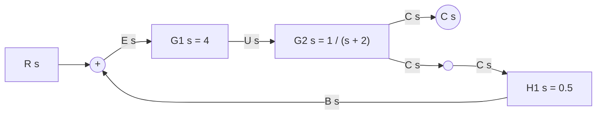
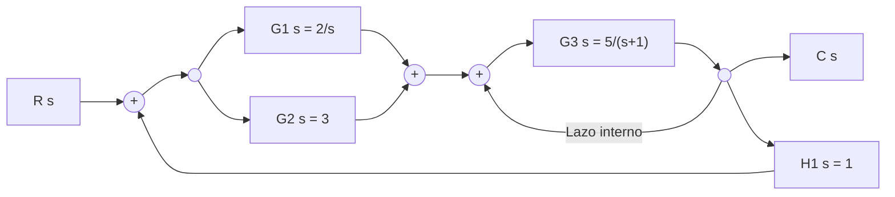
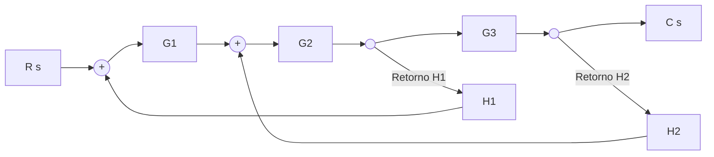

# Ejercicios Resueltos de Simulación y Simplificación de Diagramas de Bloques en Simulink

Este documento contiene una serie de ejercicios resueltos paso a paso con diferente nivel de complejidad (básico, intermedio y avanzado). En cada ejercicio se presenta la topología del diagrama original, la representación textual apta para IA (código Mermaid), el desarrollo algebraico de reducción y la verificación mediante comandos de MATLAB / Simulink.

---

## Ejercicio 1: Lazo de Realimentación Simple con Bloques en Cascada (Nivel Básico)

### Enunciado
Considere un sistema de control de posición en lazo cerrado con realimentación negativa no unitaria. 
- Entrada: $R(s)$
- Controlador: $G_1(s) = 4$
- Planta: $G_2(s) = \frac{1}{s + 2}$
- Sensor de realimentación: $H_1(s) = 0.5$
- Salida: $C(s)$

Obtener la función de transferencia equivalente $T(s) = \frac{C(s)}{R(s)}$.

### Representación en Mermaid (Legible por IA)


### Solución Paso a Paso

#### Paso 1: Combinar bloques en cascada en la trayectoria directa
Los bloques $G_1(s)$ y $G_2(s)$ están conectados en serie. La función de transferencia equivalente de la ruta directa $G_{dir}(s)$ es:
$$G_{dir}(s) = G_1(s) \cdot G_2(s) = 4 \cdot \frac{1}{s + 2} = \frac{4}{s + 2}$$

#### Paso 2: Aplicar la regla de reducción para lazo de realimentación negativa
La fórmula general para un lazo de realimentación negativa con trayectoria directa $G(s)$ y trayectoria de retorno $H(s)$ es:
$$T(s) = \frac{G_{dir}(s)}{1 + G_{dir}(s) \cdot H_1(s)}$$

Sustituyendo $G_{dir}(s) = \frac{4}{s + 2}$ y $H_1(s) = 0.5$:
$$T(s) = \frac{\frac{4}{s + 2}}{1 + \left(\frac{4}{s + 2}\right) \cdot 0.5} = \frac{\frac{4}{s + 2}}{1 + \frac{2}{s + 2}}$$

Multiplicando numerador y denominador por $(s + 2)$:
$$T(s) = \frac{4}{(s + 2) + 2} = \frac{4}{s + 4}$$

### Verificación en MATLAB / Simulink
```matlab
% Codigo para resolver en MATLAB
s = tf('s');
G1 = 4;
G2 = 1/(s + 2);
H1 = 0.5;

% Reduccion
G_dir = series(G1, G2);
T = feedback(G_dir, H1, -1);

disp('Funcion de Transferencia Equivalente T(s):');
tf(T)
```

---

## Ejercicio 2: Lazos Anidados con Rama en Paralelo (Nivel Intermedio)

### Enunciado
Dado el siguiente diagrama de bloques con dos lazos interconectados y bloques en paralelo en la trayectoria directa:
- Entrada $R(s)$, Salida $C(s)$
- Trayectoria directa primaria: $G_1(s)$ y $G_2(s)$ en paralelo que suman sus efectos.
- Bloque posterior en serie: $G_3(s)$
- Lazo de realimentación interno unitario alrededor de $G_3(s)$.
- Lazo de realimentación externo global con función $H_1(s)$.

Considere:
- $G_1(s) = \frac{2}{s}$
- $G_2(s) = 3$
- $G_3(s) = \frac{5}{s + 1}$
- $H_1(s) = 1$

### Representación en Mermaid


### Solución Paso a Paso

#### Paso 1: Reducir los bloques en paralelo $G_1(s)$ y $G_2(s)$
$$G_{par}(s) = G_1(s) + G_2(s) = \frac{2}{s} + 3 = \frac{3s + 2}{s}$$

#### Paso 2: Reducir el lazo interno de realimentación unitaria en $G_3(s)$
El bloque $G_3(s)$ tiene una realimentación negativa implícita con $H_{int}(s) = 1$:
$$G_{int}(s) = \frac{G_3(s)}{1 + G_3(s)} = \frac{\frac{5}{s + 1}}{1 + \frac{5}{s + 1}} = \frac{5}{(s + 1) + 5} = \frac{5}{s + 6}$$

#### Paso 3: Combinar en cascada $G_{par}(s)$ y $G_{int}(s)$
$$G_{dir\_total}(s) = G_{par}(s) \cdot G_{int}(s) = \left(\frac{3s + 2}{s}\right) \cdot \left(\frac{5}{s + 6}\right) = \frac{15s + 10}{s(s + 6)} = \frac{15s + 10}{s^2 + 6s}$$

#### Paso 4: Reducir el lazo de realimentación externo global ($H_1 = 1$)
$$T(s) = \frac{G_{dir\_total}(s)}{1 + G_{dir\_total}(s)} = \frac{\frac{15s + 10}{s^2 + 6s}}{1 + \frac{15s + 10}{s^2 + 6s}} = \frac{15s + 10}{s^2 + 6s + 15s + 10} = \frac{15s + 10}{s^2 + 21s + 10}$$

### Verificación en MATLAB / Simulink
```matlab
s = tf('s');
G1 = 2/s;
G2 = 3;
G3 = 5/(s + 1);

G_par = parallel(G1, G2);
G_int = feedback(G3, 1, -1);
G_dir = series(G_par, G_int);
T = feedback(G_dir, 1, -1);

disp('Funcion de Transferencia T(s):');
tf(T)
```

---

## Ejercicio 3: Lazos Cruzados / Interconectados (Nivel Avanzado)

### Enunciado
Considere un sistema de control con lazos cruzados donde un punto de bifurcación se encuentra dentro de un lazo de suma.
- Entrada $R(s)$, Salida $C(s)$
- Bloques en serie: $G_1(s), G_2(s), G_3(s)$
- Lazo de realimentación $H_1(s)$ que toma la señal entre $G_2$ y $G_3$ y regresa al primer sumador $S_1$.
- Lazo de realimentación $H_2(s)$ que toma la señal después de $G_3$ y regresa a un segundo sumador $S_2$ ubicado entre $G_1$ y $G_2$.

Considere funciones de transferencia arbitrarias $G_1, G_2, G_3, H_1, H_2$.

### Representación en Mermaid


### Solución Paso a Paso mediante Álgebra de Bloques

#### Paso 1: Identificar el desacoplamiento necesario
Los lazos se cruzan porque el punto de toma para $H_1$ está antes de $G_3$, mientras que la llegada de $H_2$ está antes de $G_2$.
Para eliminar el cruzamiento, movemos el punto de toma de $H_1$ **hacia adelante (después) del bloque $G_3$**.

#### Paso 2: Aplicar la regla de desplazamiento del punto de toma
Al mover el punto de toma de $H_1$ de la entrada de $G_3$ a la salida de $G_3$, debemos dividir la función del bloque del lazo por $G_3(s)$:
$$H_1'(s) = \frac{H_1(s)}{G_3(s)}$$

Ahora, ambos puntos de toma ($H_1'$ y $H_2$) se ubican en la salida $C(s)$, quedando en **paralelo**:
$$H_{eq\_retorno}(s) = H_2(s) + H_1'(s) = H_2(s) + \frac{H_1(s)}{G_3(s)}$$

#### Paso 3: Reducir el lazo interno formado por $G_2, G_3$ y $H_{eq\_retorno}$
Los bloques $G_2$ y $G_3$ están en serie: $G_{23} = G_2 \cdot G_3$.
El lazo cerrado interno $G_{int}$ con entrada desde $S_2$ y salida $C(s)$ es:
$$G_{int}(s) = \frac{G_2 G_3}{1 + G_2 G_3 \cdot H_{eq\_retorno}} = \frac{G_2 G_3}{1 + G_2 G_3 \left(H_2 + \frac{H_1}{G_3}\right)} = \frac{G_2 G_3}{1 + G_2 G_3 H_2 + G_2 H_1}$$

#### Paso 4: Reducir el lazo global con $G_1$
El bloque $G_1$ se encuentra en serie con $G_{int}$:
$$G_{total\_directo}(s) = G_1 \cdot G_{int}(s) = \frac{G_1 G_2 G_3}{1 + G_2 H_1 + G_2 G_3 H_2}$$

Puesto que el lazo externo $H_1$ ya fue absorbido en $H_{eq\_retorno}$, la función de transferencia global es simplemente:
$$T(s) = \frac{C(s)}{R(s)} = \frac{G_1 G_2 G_3}{1 + G_2 H_1 + G_2 G_3 H_2}$$

---

## Resumen de Fórmulas y Comandos de Verificación en MATLAB / Simulink

| Configuración | Expresión Algebraica $T(s)$ | Comando MATLAB Equivalente |
| :--- | :--- | :--- |
| **Serie (Cascada)** | $G_1 \cdot G_2$ | `series(G1, G2)` |
| **Paralelo** | $G_1 \pm G_2$ | `parallel(G1, G2)` |
| **Realimentación Negativa** | $\frac{G}{1 + GH}$ | `feedback(G, H, -1)` |
| **Realimentación Positiva** | $\frac{G}{1 - GH}$ | `feedback(G, H, +1)` |
| **Simulink Linmod** | Modelo `.slx` complete | `[A,B,C,D] = linmod('nombre_modelo')` |