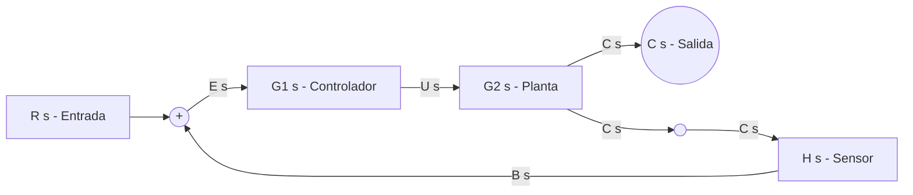

# Introducción, Fundamentos y Representación de Diagramas de Bloques en Simulink para IA y Sistemas de Control

## 1. Introducción, Concepto y Objetivos
Los **diagramas de bloques** son representaciones gráficas simplificadas y matemáticas de la dinámica de un sistema. En la ingeniería de control, robótica, aeronáutica y mecatrónica, un diagrama de bloques ilustra las relaciones de causa y efecto (entradas, estados internos y salidas) entre los diversos componentes de un sistema automatizado.

En plataformas de simulación como **Simulink** (entorno basado en modelado gráfico de MATLAB), los diagramas de bloques no solo sirven como herramientas conceptuales de dibujo, sino como **modelos ejecutables de simulación** en el dominio del tiempo y de la frecuencia.

### ¿Qué resuelve la reducción de diagramas de bloques?
1. **Obtención de la Función de Transferencia Global $T(s) = \frac{C(s)}{R(s)}$:** Permite condensar un sistema complejo con múltiples bloques de controladores, plantas, sensores y filtros en una única expresión algebraica en el dominio de Laplace ($s$).
2. **Análisis de Estabilidad y Respuesta Dinámica:** Facilita el cálculo de polos y ceros del sistema en lazo cerrado para determinar si el sistema es estable, amortiguado, oscilatorio o inestable.
3. **Diseño de Controladores:** Permite evaluar el impacto de añadir controladores (PID, Lead-Lag, estado) sobre el comportamiento global frente a referencias y perturbaciones.
4. **Optimización Computacional y de Simulación:** Reducir la complejidad estructural disminuye el tiempo de integración numérica en Simulink.

---

## 2. Componentes Fundamentales y Nombres de las Partes
Un diagrama de bloques de control está compuesto por cinco elementos canónicos:

| Componente | Nombre Técnico | Descripción y Función Matemática |
| :--- | :--- | :--- |
| **Bloque Funcional** | Función de Transferencia $G(s), H(s)$ | Elemento que procesa la señal de entrada $X(s)$ para producir $Y(s) = G(s) \cdot X(s)$. |
| **Flechas / Flechas de Señal** | Variable de Estado / Señal | Representan el flujo de información unidireccional y las variables físicas (voltaje, posición, velocidad, temperatura). |
| **Punto de Suma / Comparador** | Sumador ($\oplus$) | Realiza la suma o resta algebraica de dos o más señales: $E(s) = R(s) \mp B(s)$. |
| **Punto de Bifurcación** | Punto de Toma (Take-off point) | Permite distribuir una misma señal hacia múltiples bloques sin modificar su valor. |
| **Entradas y Salidas** | $R(s)$ (Referencia) y $C(s)$ (Salida) | Señales de excitación del sistema y la respuesta medida de la planta. |

---

## 3. Formatos de Representación de Diagramas de Bloques para Inteligencia Artificial
Las herramientas gráficas tradicionales como Simulink guardan sus modelos en archivos `.slx` (un paquete ZIP binario con XML interno) o `.mdl` (árbol de sintaxis estructurada propietario). Para que una **Inteligencia Artificial (LLM / Agente de IA)** procese, analice, simplifique o genere diagramas de bloques, se utilizan formatos textuales estructurados.

### A. Diagramas en Sintaxis Mermaid.js (Legible por IA y Renderizable)
Mermaid permite definir la topología de bloques, puntos de suma y conexiones de señal mediante código de texto plano:



### B. Representación JSON ESTRUCTURADA (Intercambio Datos IA/Simulink)
Este esquema permite a un algoritmo de IA interpretar bloques como nodos y señales como aristas dirigidas con sus respectivas funciones matemáticos:

```json
{
  "system_name": "Feedback_Control_System",
  "domain": "Laplace",
  "nodes": [
    {"id": "input_R", "type": "Input", "label": "R(s)"},
    {"id": "sum_1", "type": "SummingJunction", "signs": ["+", "-"]},
    {"id": "block_G1", "type": "TransferFunction", "numerator": [1], "denominator": [1, 2], "label": "G1(s)"},
    {"id": "block_G2", "type": "TransferFunction", "numerator": [5], "denominator": [1, 0], "label": "G2(s)"},
    {"id": "block_H1", "type": "TransferFunction", "numerator": [1], "denominator": [1], "label": "H1(s)"},
    {"id": "output_C", "type": "Output", "label": "C(s)"}
  ],
  "connections": [
    {"from": "input_R", "to": "sum_1", "port": 1},
    {"from": "sum_1", "to": "block_G1", "signal": "E(s)"},
    {"from": "block_G1", "to": "block_G2", "signal": "U(s)"},
    {"from": "block_G2", "to": "output_C", "signal": "C(s)"},
    {"from": "block_G2", "to": "block_H1", "signal": "C(s)"},
    {"from": "block_H1", "to": "sum_1", "port": 2, "signal": "B(s)"}
  ]
}
```

### C. Representación de Código MATLAB / Simulink Programático
Una IA puede generar scripts `.m` para construir dinámicamente el diagrama en Simulink mediante la API oficial:

```matlab
% Creacion programatica de diagrama de bloques en Simulink
new_system('SistemaControlIA');
open_system('SistemaControlIA');

% Agregar bloques
add_block('simulink/Sources/Step', 'SistemaControlIA/Referencia');
add_block('simulink/Math Operations/Sum', 'SistemaControlIA/Sumador');
add_block('simulink/Continuous/Transfer Fcn', 'SistemaControlIA/Planta');
add_block('simulink/Sinks/Scope', 'SistemaControlIA/Osciloscopio');

% Configurar propiedades
set_param('SistemaControlIA/Sumador', 'Inputs', '+|-');
set_param('SistemaControlIA/Planta', 'Numerator', '[10]', 'Denominator', '[1 3 10]');

% Conectar lineas entre puertos
add_line('SistemaControlIA', 'Referencia/1', 'Sumador/1');
add_line('SistemaControlIA', 'Sumador/1', 'Planta/1');
add_line('SistemaControlIA', 'Planta/1', 'Osciloscopio/1');
add_line('SistemaControlIA', 'Planta/1', 'Sumador/2', 'autorouting', 'on');
```

---

## 4. Herramientas y Reglas del Álgebra de Bloques
Las transformaciones equivalentes permiten mover sumadores y puntos de toma para desacoplar lazos cruzados.

| Regla / Operación | Diagrama Original | Diagrama Equivalente | Función de Transferencia / Relación |
| :--- | :--- | :--- | :--- |
| **1. Bloques en Serie (Cascada)** | $X 	o [G_1] 	o [G_2] 	o Y$ | $X 	o [G_1 \cdot G_2] 	o Y$ | $G_{eq}(s) = G_1(s) \cdot G_2(s)$ |
| **2. Bloques en Paralelo** | $Y = X \cdot G_1 \pm X \cdot G_2$ | $X 	o [G_1 \pm G_2] 	o Y$ | $G_{eq}(s) = G_1(s) \pm G_2(s)$ |
| **3. Lazo de Realimentación** | Directo: $G$, Retorno: $H$ | $X 	o [rac{G}{1 \pm GH}] 	o Y$ | $T(s) = rac{G(s)}{1 \mp G(s)H(s)}$ (– para negativa, + para positiva) |
| **4. Mover Sumador tras un Bloque** | Sumador antes de $G(s)$ | Sumador después de $G(s)$ | La señal secundaria debe multiplicarse por $G(s)$ |
| **5. Mover Sumador antes de un Bloque** | Sumador después de $G(s)$ | Sumador antes de $G(s)$ | La señal secundaria debe multiplicarse por $rac{1}{G(s)}$ |
| **6. Mover Punto de Toma tras un Bloque** | Toma antes de $G(s)$ | Toma después de $G(s)$ | La rama derivada debe multiplicarse por $rac{1}{G(s)}$ |
| **7. Mover Punto de Toma antes de un Bloque** | Toma después de $G(s)$ | Toma antes de $G(s)$ | La rama derivada debe multiplicarse por $G(s)$ |